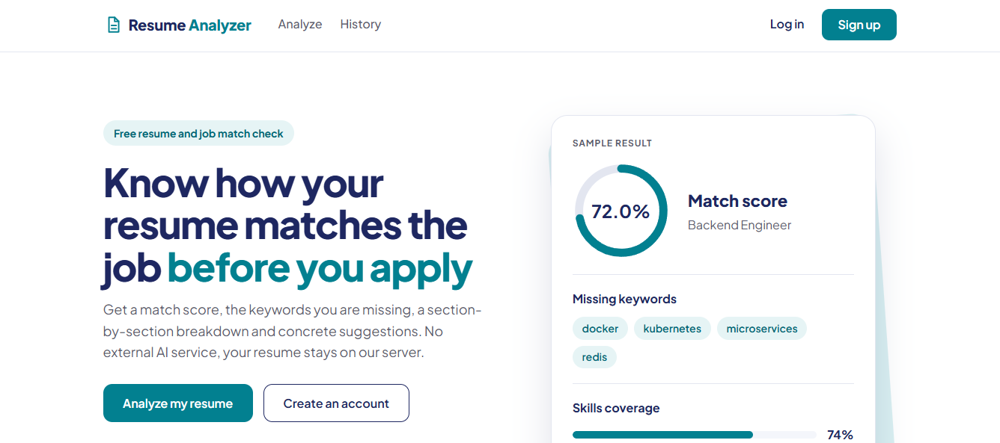
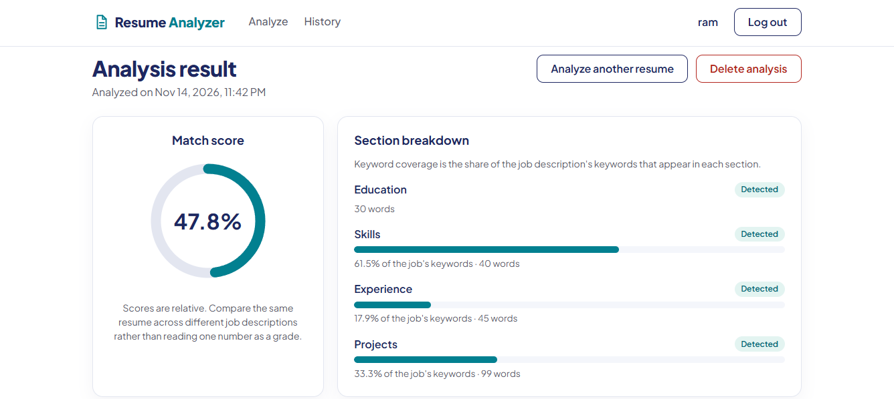
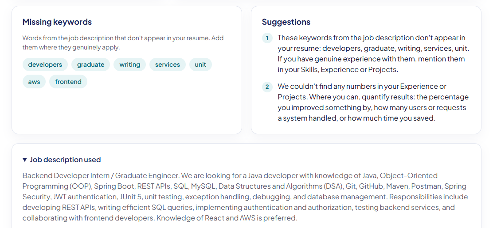

# Resume Analyzer

Compare a PDF resume with a job description and get a match score, the keywords the resume is missing, a section-by-section breakdown and concrete suggestions for improving it.

## Live demo

https://resume-analyzer-nine-cyan.vercel.app

The backend runs on a free instance that sleeps when idle, so the first request after a break can take 2 to 3 minutes.

## Screenshots







## Features

- Upload a text-based PDF resume and paste a job description.
- Match score from 0 to 100, calculated with TF-IDF weighted cosine similarity.
- Up to 15 missing keywords, ranked by how much weight they carry in the job description.
- Section breakdown for Education, Skills, Experience and Projects: whether each section was detected, its length, and (except for Education) how many of the job's keywords it contains.
- Rule-based suggestions for improving the resume.
- Sign up and log in with JWT authentication.
- History of past analyses, with the option to delete one. Deleting an analysis also removes its stored resume text when no other analysis uses it.

## How the analysis works

1. **Text extraction.** Apache PDFBox reads the text of the PDF. Encrypted PDFs, PDFs without selectable text (scanned images) and PDFs with too much text are rejected.
2. **Tokenizing.** Text is lowercased, punctuation is removed, and common stop words and single letters are dropped. A short list of technical terms is kept whole instead of being broken apart: `c++`, `c#`, `f#`, `.net`, `node.js`, `next.js`, `ci/cd`, `pl/sql`, `a/b testing`, `s3`, `ec2`, `kubernetes` (also written `k8s`), `backend`, `frontend`, `full stack`, `problem solving`, `machine learning`, `deep learning`, `data structures`, `object oriented` and `version control`. The `.js` spellings of React, Vue and Express map to `react`, `vue` and `express`.
3. **Filler words.** Words that fill job postings but are not skills ("required", "strong", "knowledge", "looking") are ignored in the score, the keyword coverage, the missing keywords and the suggestions.
4. **Score.** The resume and the job description are treated as a two-document corpus. TF-IDF weights (with smoothed IDF) feed a cosine similarity, multiplied by 100 and rounded to one decimal. Raw scores run low by design, so the interface shows no "strong match" labels. Compare the same resume across different job descriptions rather than reading one number as a grade.
5. **Missing keywords.** Job description terms that do not appear in the resume, ranked by weight in the job description and capped at 15.
6. **Sections.** Headings are detected from a list of common names, ALL-CAPS heading words, letters spaced out by PDF extraction, and inline headings such as `Skills: ...`. A section needs at least three words to count as present.
7. **Suggestions.** Rules for low overall overlap (score under 15), low skills coverage (under 25%), the top five missing keywords, sections that could not be detected, and a lack of numbers in Experience or Projects.

All of this runs inside the application. No external analysis service is called.

## Tech stack

| Part | Technology |
|---|---|
| Frontend | React 19, Vite 8, react-router-dom 7, axios, plain CSS, oxlint |
| Backend | Java 21, Spring Boot 3.3.4 (Web, Data JPA with Hibernate, Security, Validation), jjwt 0.12.6, Apache PDFBox 2.0.29, Flyway, Maven |
| Database | MySQL (TiDB Cloud when hosted) |
| Tests | JUnit 5, Mockito |
| Hosting | Vercel (frontend), Render with Docker (backend), TiDB Cloud (database) |

## Project structure

```
resume-analyzer/
├── client/    React app (Vite)
├── server/    Spring Boot API and its Dockerfile
└── docs/      Screenshots used in this README
```

- `server/src/main/java/com/resumeanalyzer/` contains the packages `config`, `controller`, `converter`, `dto`, `entity`, `exception`, `repository`, `security` and `service`.
- The scoring code (`TextTokenizer`, `JobDescriptionFiller`, `ScoringEngine`, `SectionAnalyzer`, `SuggestionEngine`, `PdfExtractor`) is plain Java without framework dependencies, wrapped by thin Spring services.
- Database migrations are in `server/src/main/resources/db/migration`. Flyway applies them on startup, and Hibernate only validates that the entities match the schema.
- `client/src` contains `components`, `pages`, `context`, `hooks`, `services` and `utils`.

## Getting started

### Prerequisites

- Java 21 and Maven
- MySQL 8 or newer
- Node.js 20.19 or newer, or 22.12 or newer

### Database

Create a database and a dedicated user (choose your own password):

```sql
CREATE DATABASE resume_analyzer_dev CHARACTER SET utf8mb4;
CREATE USER 'resume_app'@'localhost' IDENTIFIED BY 'choose-a-password';
GRANT ALL PRIVILEGES ON resume_analyzer_dev.* TO 'resume_app'@'localhost';
```

### Backend

`DB_USER`, `DB_PASSWORD` and `JWT_SECRET` are required, and the server refuses to start without them. Use a random `JWT_SECRET` of at least 32 characters.

macOS or Linux:

```bash
cd server
export DB_USER=resume_app
export DB_PASSWORD=choose-a-password
export JWT_SECRET=replace-with-a-long-random-string-of-32-or-more-characters
mvn spring-boot:run
```

Windows PowerShell:

```powershell
cd server
$env:DB_USER = "resume_app"
$env:DB_PASSWORD = "choose-a-password"
$env:JWT_SECRET = "replace-with-a-long-random-string-of-32-or-more-characters"
mvn spring-boot:run
```

The API starts on http://localhost:8080 and creates the tables on the first start.

### Frontend

```bash
cd client
npm install
npm run dev
```

The app opens on http://localhost:5173 and talks to http://localhost:8080/api by default. To use another backend, set `VITE_API_URL` (for example in `client/.env.local`).

## Configuration

Backend settings, read from environment variables:

| Variable | Required | Default | Purpose |
|---|---|---|---|
| `DB_USER` | yes | | Database user |
| `DB_PASSWORD` | yes | | Database password |
| `JWT_SECRET` | yes | | Key used to sign tokens (32 or more characters) |
| `DB_URL` | no | built from the three settings below | Full JDBC URL. Overrides the settings below, which hosted databases need for TLS options |
| `DB_HOST` | no | `127.0.0.1` | Database host |
| `DB_PORT` | no | `3306` | Database port |
| `DB_NAME` | no | `resume_analyzer_dev` | Database name |
| `JWT_EXPIRATION_MS` | no | `86400000` (24 hours) | Token lifetime |
| `CORS_ALLOWED_ORIGINS` | no | `http://localhost:5173` | Comma-separated list of allowed frontend origins, written exactly as the browser sends them (no trailing slash) |
| `PORT` | no | `8080` | Server port; hosting platforms usually provide it |

The background cleanup of unused uploads can be adjusted with the application properties `cleanup.unused-resume-max-age-hours` (default 24), `cleanup.initial-delay-ms` (default 60000) and `cleanup.interval-ms` (default 3600000).

Frontend setting: `VITE_API_URL` (default `http://localhost:8080/api`). Vite writes it into the build, so set it before building.

## API

All endpoints are under `/api`. Protected endpoints expect `Authorization: Bearer <token>`.

| Method and path | Auth | Description |
|---|---|---|
| `GET /health` | no | `{"status":"ok"}` |
| `POST /auth/signup` | no | Creates a user. 201 with the user, 409 for a duplicate email, 400 with `fieldErrors` for invalid input |
| `POST /auth/login` | no | 200 with `{token, user}`. 401 with a generic message for wrong credentials |
| `POST /resumes` | yes | Multipart upload, field name `file`. 201 with `{id, originalFilename, uploadedAt}`. 400 for non-PDF, scanned or over-long documents, 413 for files over the size limit |
| `POST /analyses` | yes | Body `{resumeId, jobDescriptionText}`. 201 with the analysis. 404 if the resume is not the caller's |
| `GET /analyses` | yes | The caller's analyses, newest first: `{id, resumeId, resumeFilename, matchScore, createdAt}` |
| `GET /analyses/{id}` | yes | One full analysis. 404 if it is not the caller's |
| `DELETE /analyses/{id}` | yes | 204. Also removes the resume when no other analysis uses it. 404 if it is not the caller's |

An analysis looks like this (values are illustrative):

```json
{
  "id": 12,
  "resumeId": 7,
  "jobDescriptionText": "...",
  "matchScore": 47.8,
  "missingKeywords": ["kubernetes", "ci/cd"],
  "sectionScores": {
    "education": { "present": true, "wordCount": 24 },
    "skills": { "present": true, "wordCount": 40, "keywordCoverage": 33.3 },
    "experience": { "present": true, "wordCount": 45, "keywordCoverage": 25.0 },
    "projects": { "present": true, "wordCount": 14, "keywordCoverage": 16.7 }
  },
  "suggestions": ["..."],
  "createdAt": "2026-11-12T07:34:20Z"
}
```

Timestamps are ISO-8601 in UTC. The order of keys inside `sectionScores` is not guaranteed, so clients should not rely on it.

### Error format

Every error uses the same shape, including the 401 and 403 responses from the security layer:

```json
{
  "timestamp": "2026-11-12T07:34:20Z",
  "status": 400,
  "error": "Bad Request",
  "message": "Validation failed",
  "path": "/api/auth/signup",
  "fieldErrors": { "email": "must be a well-formed email address" }
}
```

`fieldErrors` appears only for validation errors, and its messages here are examples. Unexpected server errors return a generic 500 message, and the details stay in the server log.

### Limits

| Item | Limit |
|---|---|
| PDF file | 5 MB |
| Extracted resume text | 100,000 characters |
| Job description | 20,000 characters |
| Missing keywords returned | 15 |
| Resumes with no analysis | removed after 24 hours |

## Security

- Passwords are hashed with BCrypt. Tokens are signed JWTs carrying the user id and email.
- Ownership is enforced inside the repository queries. Another user's resume or analysis returns 404, which is indistinguishable from one that does not exist.
- CORS allows only the origins listed in `CORS_ALLOWED_ORIGINS`.
- Secrets come from environment variables. The server will not start without a JWT secret.
- Uploads are validated for type, size and readable text before anything is stored. Only the extracted text is kept, never the PDF file itself.

## Testing

```bash
cd server
mvn test
```

The backend suite uses JUnit 5 and Mockito. It covers the tokenizer, scoring, section detection, suggestions, filler words, PDF extraction, ownership and deletion rules, the cleanup job, configuration parsing, the error handler and request validation. For the frontend, run `npm run lint` and `npm run build` from `client`.

## Deployment

The app is deployed as three separate parts:

- **Frontend: Vercel.** Root directory `client`, framework preset Vite, and the environment variable `VITE_API_URL` pointing at the backend's `/api`. `client/vercel.json` rewrites every path to `index.html` so that refreshing a page such as `/history` works.
- **Backend: Render, using Docker.** Dockerfile path `server/Dockerfile`, build context `server`, health check path `/api/health`. Set `DB_URL`, `DB_USER`, `DB_PASSWORD`, `JWT_SECRET` and `CORS_ALLOWED_ORIGINS` as environment variables. The platform's `PORT` is picked up automatically. The image accepts extra JVM flags through `JAVA_OPTS`.
- **Database: TiDB Cloud Starter (MySQL compatible).** Use a JDBC URL with TLS, for example `jdbc:mysql://<host>:4000/<database>?sslMode=VERIFY_IDENTITY`. Flyway creates the schema on the first start.

`CORS_ALLOWED_ORIGINS` must contain the frontend's address exactly as the browser shows it, for example `https://your-app.vercel.app`.

## Limitations

- **Section detection is heuristic.** Unusual headings, two-column layouts, ALL-CAPS job titles that contain a heading word (such as "VOLUNTEER COORDINATOR") and a standalone "Languages" label inside a table-style Skills block can split sections in the wrong place.
- **The tokenizer knows only a fixed list of technical terms.** Terms that are not on the list still break apart, for example `T-SQL`, `Objective-C` and `OAuth2`. A language written as a single letter, such as `C` or `R`, cannot be told apart from ordinary text. "Spring Boot" is deliberately two words, so a resume that mentions only "Spring" still earns partial credit. There is no stemming, so "API" and "APIs" count as different words.
- **Matching is lexical.** There is no understanding of synonyms, so "JS" and "JavaScript", or "Postgres" and "PostgreSQL", do not match each other.
- **Scores are relative.** Raw TF-IDF scores run low, and they are only comparable for the same job description.
- **Image-only PDFs are not supported.** There is no OCR, and PDFs with unusual layouts can produce text in an odd order.
- **Results are a snapshot.** An analysis keeps the score and keywords calculated when it was created, even if the scoring rules change later.
- **The original PDF is not stored.** It can neither be downloaded nor re-analyzed later; only the extracted text is kept.
- **The history list shows no score trend.** Scores are only comparable for the same job description, and the list does not identify the job description.
- **Session handling.** The token is kept in `localStorage`, where injected scripts could read it; httpOnly cookies would need backend changes. Logging out in one tab does not update other open tabs. After login, the redirect keeps the page path but not its query string.
- **Accounts.** There is no password reset, email verification or rate limiting.
- **Tests.** The frontend has no automated tests. Ownership rules are tested at the service level with mocked repositories, and the SQL itself was checked by hand with two users. There are no integration tests against a real database (for example with Testcontainers).
- **Hosting.** The backend runs on a free instance that sleeps when idle, and the database uses a free monthly quota.
